<!-- ═══════════════════════════ HERO ═══════════════════════════ -->

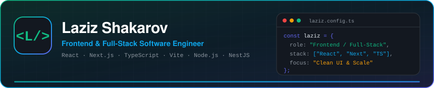

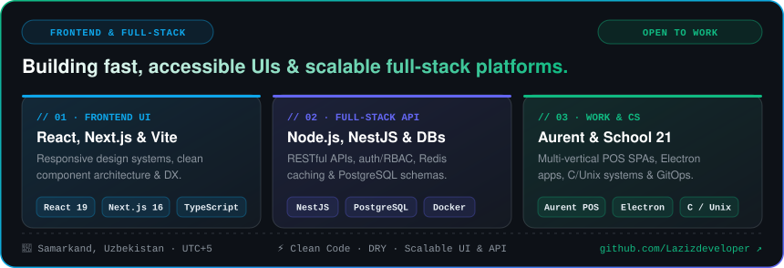

 

  

 

<!-- ═══════════════════════════ 01 ABOUT ═══════════════════════════ -->
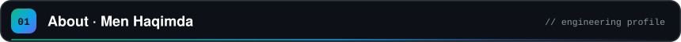

 

### Frontend & Full-Stack Engineer — React · Next.js · TypeScript · Vite · NestJS

I build responsive, accessible web applications and scalable full-stack systems with clean component architecture, strict type safety, and maintainable code. 
Zamonaviy frontend (React, Next.js, TypeScript, Vite) hamda barqaror backend API (Node.js, NestJS, PostgreSQL, Docker) tizimlarini yarataman.

 

- 🏫 **School 21** *(2025 – present)* — C, Unix systems, algorithms &amp; data structures
- 🎓 **Najot Ta'lim** *(2025 – present)* — Full-Stack JavaScript/TypeScript, NestJS, Microservices &amp; DevOps
- 💼 **Production Focus** — Marketplaces with escrow, booking platforms, high-load REST APIs &amp; GitOps automation

⚡ Clean Code (DRY / SRP) &nbsp;·&nbsp; 🧩 Component Architecture &nbsp;·&nbsp; 🛡️ Type Safety &nbsp;·&nbsp; 🚀 Scalable Systems

 

<!-- ═══════════════════════════ 02 TECH STACK ═══════════════════════════ -->
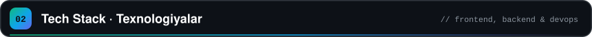

 

  

  

  

  

  

  

  
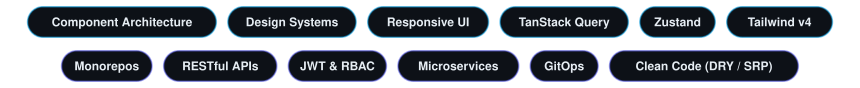

 

<!-- ═══════════════════════════ 03 METRICS ═══════════════════════════ -->
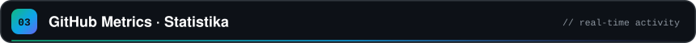

 

  

  

<picture>
  <source media="(prefers-color-scheme: dark)" srcset="https://raw.githubusercontent.com/Lazizdeveloper/Lazizdeveloper/output/github-contribution-grid-snake-dark.svg" />
  <source media="(prefers-color-scheme: light)" srcset="https://raw.githubusercontent.com/Lazizdeveloper/Lazizdeveloper/output/github-contribution-grid-snake.svg" />
  
</picture>

 

<!-- ═══════════════════════════ 04 PROJECTS ═══════════════════════════ -->
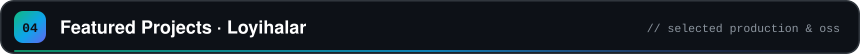

 

<a href="https://github.com/BoboLoladono/Bobo-Doda">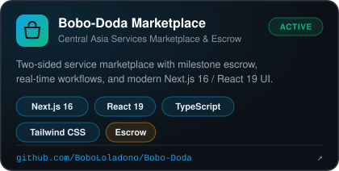</a>
<a href="https://github.com/Lazizdeveloper/Safaarsave">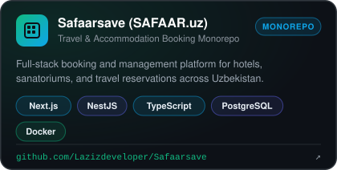</a>

<a href="https://github.com/Lazizdeveloper/bookback">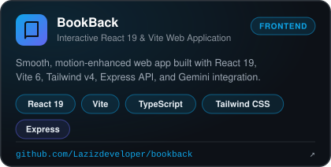</a>
<a href="https://github.com/Lazizdeveloper/Mahalla_yettiligi_backend">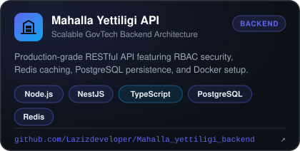</a>

<a href="https://github.com/Lazizdeveloper/uptime-monitor">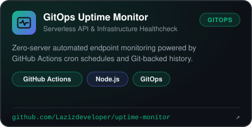</a>
<a href="https://github.com/Lazizdeveloper/antigravity-multi-account-rotator">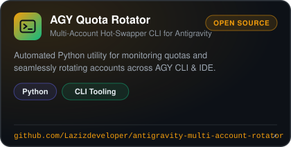</a>

  

| Project / Loyiha | Description (EN / UZ) | Stack | Repo |
| :--- | :--- | :--- | :--- |
| 🤝 **Bobo-Doda** | Central Asia two-sided service marketplace with milestone escrow / Xizmatlar marketplace | `Next.js 16` · `React 19` · `TypeScript` · `Tailwind` | [Code](https://github.com/BoboLoladono/Bobo-Doda) |
| 🏨 **Safaarsave** | Travel & accommodation booking monorepo / Bron qilish va boshqaruv tizimi | `Next.js` · `NestJS` · `TypeScript` · `PostgreSQL` | [Code](https://github.com/Lazizdeveloper/Safaarsave) |
| 📚 **BookBack** | Interactive React 19 + Vite web app with motion UI & Gemini API / Zamonaviy veb-ilova | `React 19` · `Vite` · `TypeScript` · `Tailwind v4` | [Code](https://github.com/Lazizdeveloper/bookback) |
| 🏛️ **Mahalla Yettiligi** | Scalable GovTech REST API with RBAC, Redis & Docker / To'liq backend API servisi | `Node.js` · `NestJS` · `PostgreSQL` · `Redis` | [Code](https://github.com/Lazizdeveloper/Mahalla_yettiligi_backend) |
| 🌐 **Uptime Monitor** | GitOps serverless API & endpoint healthcheck / Avtomatik monitoring tizimi | `GitHub Actions` · `Node.js` · `GitOps` | [Code](https://github.com/Lazizdeveloper/uptime-monitor) |
| ⚡ **AGY Quota Rotator** | Automated multi-account quota hot-swapper CLI / Kvota boshqaruvchi CLI | `Python` · `CLI Tooling` | [Code](https://github.com/Lazizdeveloper/antigravity-multi-account-rotator) |

 

<!-- ═══════════════════════════ 05 CONNECT ═══════════════════════════ -->
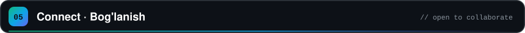

 

  

🎮 Interactive Tic-Tac-Toe / Profilingizda jonli Krestik-Nolik o'ynang

 

<!-- TIC_TAC_TOE_START -->

🎮 **Sizning navbatingiz (❌)!** Bo'sh katakchalardan birini bosing:

| 1 | 2 | 3 |
| :---: | :---: | :---: |
| [⬜](https://github.com/Lazizdeveloper/Lazizdeveloper/issues/new?title=ttt%7C0%7C0&body=Hech+narsani+o%27zgartirmang.+Faqat+%27Submit+new+issue%27+tugmasini+bosing.) | [⬜](https://github.com/Lazizdeveloper/Lazizdeveloper/issues/new?title=ttt%7C0%7C1&body=Hech+narsani+o%27zgartirmang.+Faqat+%27Submit+new+issue%27+tugmasini+bosing.) | ⭕ |
| [⬜](https://github.com/Lazizdeveloper/Lazizdeveloper/issues/new?title=ttt%7C1%7C0&body=Hech+narsani+o%27zgartirmang.+Faqat+%27Submit+new+issue%27+tugmasini+bosing.) | ❌ | [⬜](https://github.com/Lazizdeveloper/Lazizdeveloper/issues/new?title=ttt%7C1%7C2&body=Hech+narsani+o%27zgartirmang.+Faqat+%27Submit+new+issue%27+tugmasini+bosing.) |
| [⬜](https://github.com/Lazizdeveloper/Lazizdeveloper/issues/new?title=ttt%7C2%7C0&body=Hech+narsani+o%27zgartirmang.+Faqat+%27Submit+new+issue%27+tugmasini+bosing.) | [⬜](https://github.com/Lazizdeveloper/Lazizdeveloper/issues/new?title=ttt%7C2%7C1&body=Hech+narsani+o%27zgartirmang.+Faqat+%27Submit+new+issue%27+tugmasini+bosing.) | [⬜](https://github.com/Lazizdeveloper/Lazizdeveloper/issues/new?title=ttt%7C2%7C2&body=Hech+narsani+o%27zgartirmang.+Faqat+%27Submit+new+issue%27+tugmasini+bosing.) |

  

> 📊 **O'yinlar statistikasi:** Jami o'yinlar: **0** | O'yinchilar yutug'i: **0** | Bot yutug'i: **0** | Durang: **0**

<!-- TIC_TAC_TOE_END -->

 

Built in Samarkand · shipped with React, Next.js, TypeScript &amp; NestJS.

